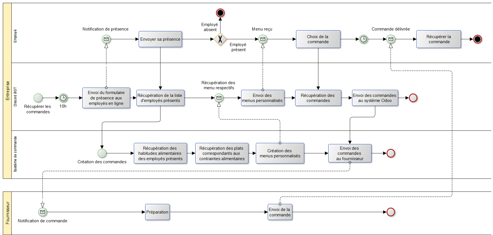
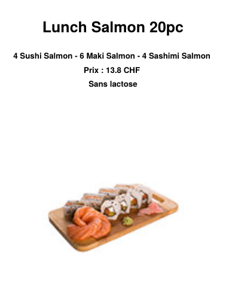

# Bot Discord de commande de repas connecté à Odoo

*Projet d'intégration : Système d'information d'entreprise, Université de Genève, 2024*

Un chatbot Discord qui permet aux employés d'une entreprise de commander leur repas de midi directement dans Discord. Les commandes sont enregistrées automatiquement dans le module **Lunch** de l'ERP **Odoo**.

Le module Lunch d'Odoo ne tient pas compte des régimes alimentaires : chaque employé doit chercher lui-même les plats qui lui conviennent. Ce projet ajoute donc à Odoo le régime alimentaire des employés et des plats (végétarien, vegan, sans porc, sans gluten, sans lactose). Le bot peut ainsi envoyer à chacun un **menu personnalisé**.

## Fonctionnement

1. Le bot envoie en message privé un **formulaire de présence** à tous les membres en ligne du serveur.
2. Quand un employé répond présent (réaction ✅), le bot récupère son régime alimentaire dans Odoo. Il lui envoie ensuite un **menu PDF** avec les plats compatibles : photo, description, prix et régime.
3. L'employé écrit au bot le nom du ou des plats choisis. Le bot vérifie que chaque plat existe.
4. Une fois le délai de commande passé, le bot crée les commandes dans le module Lunch d'Odoo, qui les transmet au fournisseur.

| Processus de commande avec le bot (BPMN) | Exemple de menu envoyé |
|---|---|
|  |  |

## Technologies

- **Python** avec [discord.py](https://discordpy.readthedocs.io/) pour le bot
- L'**API externe d'Odoo** (XML-RPC) pour lire et écrire dans les modules Employés et Lunch, avec les méthodes `search_read`, `create` et `write`. Elle sert aussi à créer de nouveaux champs : régime alimentaire et pseudo Discord.
- **fpdf2** pour générer les menus en PDF
- **BPMN** pour modéliser le processus avant et après l'intégration

## Structure

```
├── discord_lunch_bot_without_close.py  # Bot (version principale, reste en ligne)
├── discord_lunch_bot_with_close.py     # Variante qui se déconnecte une fois les commandes passées (expérimentale)
├── lunch_data.py    # Fonctions Odoo : plats, régimes alimentaires, création des commandes
├── hr_data.py       # Fonctions Odoo : employés, habitudes alimentaires, pseudo Discord
├── users_data.py    # Fonctions Odoo : utilisateurs
├── config.py        # Lecture de la configuration (.env)
├── *.json           # Copies locales des données Odoo (employés, plats, utilisateurs…)
└── images/          # Images des plats du menu en cours
```

## Installation

**Prérequis :** Python 3.9 ou plus récent, une instance **Odoo 17** avec les modules *Employés* et *Lunch*, et un serveur Discord.

1. **Installer les dépendances**
   ```bash
   pip install discord.py fpdf2 schedule python-dotenv
   ```

2. **Créer le bot Discord** sur le [portail développeur Discord](https://discord.com/developers/applications) :
   - activer les trois *Privileged Gateway Intents* : *Presence*, *Server Members* et *Message Content* ;
   - copier le token du bot ;
   - inviter le bot sur le serveur.

3. **Configurer** : copier `.env.example` en `.env`, puis renseigner le token Discord et les identifiants Odoo (URL, base de données, utilisateur et mot de passe).

4. **Préparer la base Odoo** (une seule fois, sur une base non modifiée) en lançant les fonctions qui créent les nouveaux champs et les remplissent :
   ```bash
   python -c "import lunch_data as l; l.new_field_lunch(); l.show_lunch_info(); l.update_lunch_diet()"
   python -c "import hr_data as h; h.new_field_hr(); h.new_discord_field(); h.show_employees_json(); h.set_lunch_habits_employees()"
   ```
   Les régimes alimentaires sont attribués aléatoirement, pour la démonstration.

5. **Associer les employés à leur compte Discord** : renseigner le champ *discord* de chaque employé dans Odoo. Régénérer ensuite les fichiers JSON des employés et des utilisateurs :
   ```bash
   python -c "import hr_data as h; h.show_employees_json()"
   python users_data.py
   ```
    Sans cette correspondance, le bot ne peut pas identifier qui commande.

## Utilisation

```bash
python discord_lunch_bot_without_close.py
```

Au lancement, le bot envoie le formulaire de présence aux membres en ligne. L'employé ajoute la réaction ✅ au message pour recevoir son menu. Il envoie ensuite le nom exact d'un plat (par exemple `Pizza Italiana`). Après le délai d'attente (30 secondes dans le code, modifiable), la commande est créée dans Odoo.

## Limites et pistes d'amélioration

- Le déclenchement automatique chaque jour de semaine à 10h est prévu dans le code mais désactivé : le bot démarre le processus à son lancement.
- La version `with_close` se déconnecte bien après les commandes, mais génère des erreurs dans les logs lors de la déconnexion.
- Le menu pourrait devenir interactif, avec des boutons Discord, au lieu de demander de taper le nom du plat.
